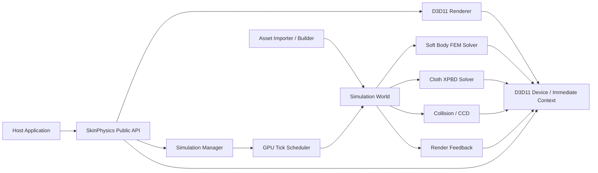
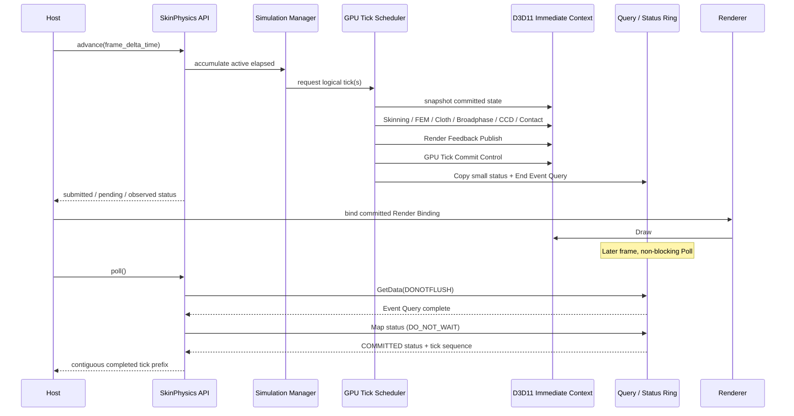
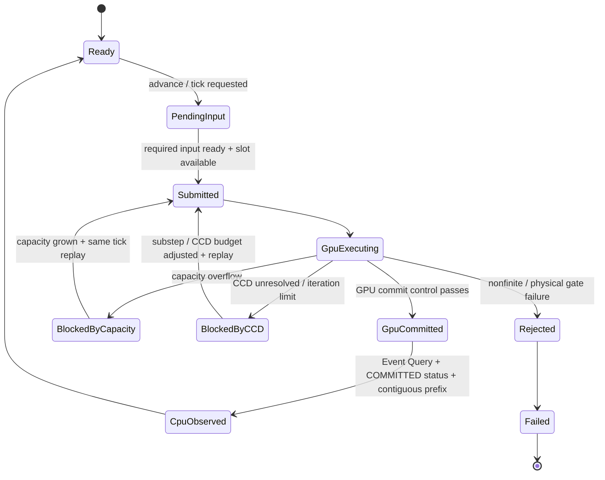

# Phase 12 — GPU Runtime Transaction / Render Integration

## 1. Component boundary



Host owns the D3D11 Device / Immediate Context and Renderer. SkinPhysics retains COM references and owns Simulation World state, physics resources, and the asynchronous scheduler. The same Immediate Context is used by Host Renderer and SkinPhysics on one submission thread.

## 2. Logical tick normal path



GPU command submission and CPU observation are separate events. Event Query completion proves command completion; the GPU Status Buffer determines whether a Logical Tick committed.

The Runtime permits up to two submitted-but-not-observed ticks. Each immutable Dispatch Plan contains the expected predecessor sequence and source State Generation. Tick N+1 checks the GPU Commit result of N before any Physics State read/write. If N fails, N+1 is blocked before touching Physics State and must be resubmitted after N is successfully replayed.

## 3. Capacity / CCD failure and retry

```mermaid
sequenceDiagram
    participant G as GPU Tick Scheduler
    participant D as D3D11 GPU
    participant Q as Query / Status Ring
    participant C as CPU Runtime Control

    G->>D: preserve tick-start snapshot
    G->>D: Count / Scan / Capacity Check
    D-->>G: overflow or unresolved CCD flag
    G->>D: set BLOCKED / REJECTED; suppress downstream writes
    G->>Q: Copy small error status + Event Query
    Note over Q: GPU completion remains asynchronous
    C->>Q: Poll Event Query
    Q-->>C: completed
    C->>Q: Map status DO_NOT_WAIT
    Q-->>C: required capacity / error counters
    C->>C: grow validated GPU resource on submission thread
    C->>G: retry same logical tick / same initial snapshot
    G->>D: rerun with unchanged tick input
    D-->>G: Commit only after all gates pass
```

No candidate is silently dropped. The failed working state is not published to Renderer. If the error cannot be repaired within configured limits, the World remains blocked or failed and simulation time is not advanced.

## 4. Submission and completion state



The CPU-observed completed time advances only from the contiguous COMMITTED tick prefix. Render Binding exposes committed data only.

## 5. Key implementation invariants

1. A Logical Tick is the smallest GPU Commit transaction.
2. All GPU passes are issued on one ordered D3D11 Immediate Context.
3. GPU-generated variable work counts use GPU-generated DispatchIndirect arguments or fixed upper-bound Dispatch with a GPU-side lane guard; no synchronous Count Readback is used to size a dispatch.
4. Any Buffer capacity error blocks Fill / Consumer / Commit and records required capacity.
5. Rollback replays the exact same Logical Tick input and initial state.
6. Soft Body Tet Force uses Tet Contribution + Vertex CSR Gather; no floating-point Atomic Add.
7. Cloth and Contact XPBD apply the same projected Lambda Delta to both Lambda and Position.
8. Render Feedback reads only the committed physics state and is published after the Tick succeeds.
9. Full Physics Vertex / Contact / Lambda readback is prohibited in the normal frame path.
10. WARP validates shader execution and readback correctness; physical GPU runs validate performance and memory.
