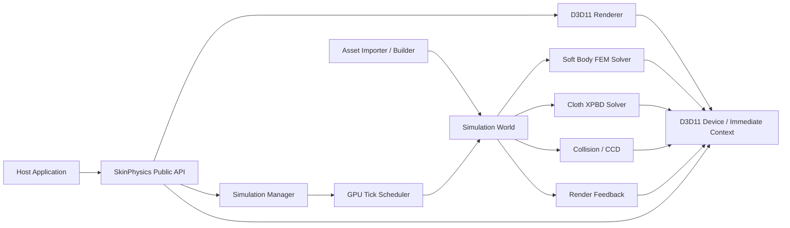
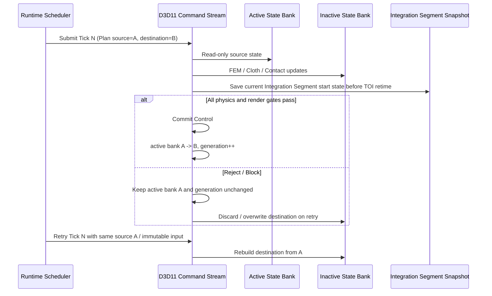
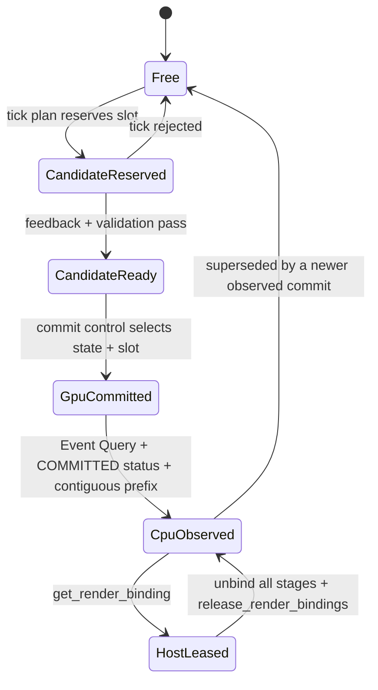

# Phase 12 — GPU Runtime Transaction / Render Integration

## 1. Component boundary



Host owns the D3D11 Device / Immediate Context and Renderer. SkinPhysics retains COM references and owns Simulation World state, physics resources, and the asynchronous scheduler. The same Immediate Context is used by Host Renderer and SkinPhysics on one submission thread.

## 2. Logical tick normal path

```mermaid
sequenceDiagram
    participant H as Host
    participant API as SkinPhysics API
    participant S as Simulation Manager
    participant G as GPU Tick Scheduler
    participant D as D3D11 Immediate Context
    participant Q as Query / Status Ring
    participant R as Renderer

    H->>API: advance(frame_delta_time)
    API->>S: add elapsed to requested time (Playing only)
    S->>S: prepare candidate Animation Span Packets / Collider Records / boundary table (no time reservation yet)
    S->>G: request Render Candidate + Query + in-flight slots
    G-->>S: resource slots reserved
    S->>S: move one fixed dt from Accumulator to Tick Reservation; pin Input / Packet Version
    S->>G: submit reserved sequence + immutable input snapshot
    G->>G: preflight World Substep / Animation / Force / Impulse segment count
    Note over S,G: CPU Preflight over cap -> BLOCKED / cpu_preflight; exact planned counts enter CPU Status Queue, no Physics Dispatch / Event Query; unused Query and Render Candidate slots are released
    G->>D: predecessor / State Generation gate
    G->>D: upload immutable Animation Trajectory Span Packets / Collider Records + Bounds
    G->>D: initialize per-World Mutable Span Cursor Buffer from Tick Reservation
    Note over D: Immutable Packet Records are SRV-only; normalized u lives in a separate per-World Cursor UAV
    loop each World Integration Segment
        G->>D: evaluate Animation Packet at Segment start/end
        G->>D: evaluate exact Animation / Kinematic Trajectory at every CA tau
        G->>D: update Mutable Cursor only; keep Packet bytes / Version immutable
        G->>D: distribute Force / Impulse events once
        G->>D: Soft Body FEM + Cloth prediction
        G->>D: broadphase / narrowphase / CCD candidate discovery
        G->>D: CA / TOI prefix path selection
        G->>D: solve non-contact internal constraints
        G->>D: save Dynamic v_pre_contact before Contact XPBD
        G->>D: snapshot Cursor with Segment start for TOI / Retry rollback
        G->>D: Contact positional projection (position only)
        G->>D: non-responsive W_eff guard
        G->>D: coupled Projected Jacobi impulse iterations + CSR Gather
        G->>D: validate Normal / Coulomb Cone Residual
        G->>D: advance Cursor after Segment; Span boundary switches Record and resets u=0
    end
    G->>D: prepare Render Candidate (Position / Normal / Tangent)
    G->>D: validate Render Candidate + Physics State
    G->>D: GPU Commit Control (Physics State + Render Slot atomically)
    G->>Q: copy tick / state / render-slot status + Event Query
    API-->>H: submitted / pending / observed status
    Note over Q: Later frame, non-blocking Poll
    H->>API: advance(frame_delta_time) / poll()
    API->>Q: GetData(DONOTFLUSH)
    Q-->>API: Event Query complete
    API->>Q: Map status (DO_NOT_WAIT)
    Q-->>API: COMMITTED + tick / state generation / render slot
    API-->>H: contiguous CPU-observed committed prefix
    H->>API: get_render_binding(world, model, mesh)
    API-->>H: Render Slot lease + read-only SRVs
    H->>R: bind Render Binding
    R->>D: Draw
    H->>R: Unbind VS / HS / DS / GS / PS / CS SRVs
    H->>API: release_render_bindings(world, lease_generation)
```

The loop body is executed per World Integration Segment, not once per Solver independently. Before GPU Physics Dispatch, CPU Preflight counts World Substeps and planned Animation Span / Force / Impulse boundary Segments against the Admission Limits after Tick Reservation creation. A CPU Preflight overrun enters BLOCKED with origin cpu_preflight and exact planned_substeps / planned_integration_segments in the CPU Status Queue; it issues no Physics Upload / Dispatch / Event Query and releases unused Query / Render Candidate slots. poll() returns this CPU result synchronously. A TOI-created residual Segment is counted only when discovered during GPU execution. If it exceeds the Admission Limit, GPU reports executed_integration_segments and minimum_required_integration_segments, where the latter is a proven lower bound that excludes undiscovered later TOIs. GPU Dynamic TOI status is returned through Status Buffer + Event Query. Both paths preserve the same Tick Reservation / Packet Version and never coalesce distinct boundary times. For CCD, the TOI prefix state must be sampled from the same semi-implicit discrete path used by Conservative Advancement; do not re-predict the prefix using dt=tau, because that changes the path. Kinematic endpoint chords are used only as conservative Swept AABB reference shapes expanded by the full-interval deviation bound. Conservative Advancement / TOI positions evaluate the exact Animation / Rigid Transform Trajectory at tau and use its conservative interval speed bound; Contact Relative Velocity uses the exact trajectory derivative. A World Substep is split at Animation Span Key / Loop / Blend Weight / Root Transform boundaries, Force start/end, one-shot Impulse time, and TOI. contact_max_substep_delta_time=0 means +infinity / no Contact-specific cap; otherwise it participates in the minimum World dt. At Segment Begin the Runtime captures the shared start state, selects the immutable Animation Trajectory Packet / Bound Version, evaluates target / velocity at boundaries, and distributes constant Force for the interval. The GPU evaluator also evaluates the exact packet at arbitrary TOI tau. Impulse Event at the start is consumed exactly once. Soft Body evaluates FEM / Kelvin-Voigt forces from that Segment start state; Cloth evaluates its external force input. Both use the common Segment integration rule in detailed_design.md §6.6. After non-contact internal XPBD constraints and before Contact Position XPBD, only Dynamic Vertex velocity is reconstructed from segment displacement and saved as v_pre_contact. Contact Position correction changes Position only and never participates in velocity reconstruction; friction / restitution use the saved v_pre_contact plus the exact Kinematic Trajectory Velocity. Contacts with W_eff <= epsilon_inverse_mass are skipped as non-responsive; all other contacts are solved together by Projected Jacobi iterations and Gather, with Commit gated on residual convergence. Fixed / Kinematic Vertex retains the Animation Interface's prescribed derivative and is never modified by contact impulses. An Impact-updated Dynamic Velocity becomes the next Segment's start velocity.

GPU command submission and CPU observation are separate events. Event Query completion proves command completion; the GPU Status Buffer determines whether a Logical Tick committed. Render Candidate is produced before Commit, but its slot becomes visible only when the same GPU Commit Control atomically selects the committed Physics State and Render Slot. The Host receives only the latest CPU-observed committed prefix. A World has one active Render Lease, and its ring contains maximum_in_flight_ticks + 1 slots; a slot cannot be reused until it is no longer in flight / unobserved and its Host lease has been released.

A Tick Reservation owns its fixed-time interval from submission through Retry / Block until GPU Commit. A transient reject never returns time to the Accumulator and never allocates a new Tick Sequence. CPU Observation updates status only; it never consumes or refunds simulation time. World Substep schedule is common to Soft Body / Cloth / Contact / Animation Tracking, and TOI / Force event boundaries split time for every participant.

The Runtime permits `maximum_in_flight_ticks` submitted-but-not-CPU-observed ticks per World (supported values 1 / 2 / 4; default 2). In-flight counts CPU-unobserved Submission Attempts, not simultaneous GPU Physics State writers. All batches execute serially on the single ordered Immediate Context Command Stream. The two Persistent State Banks are reused in alternating order only after each predecessor Commit Gate succeeds. Each immutable Dispatch Plan contains the expected predecessor sequence and source State Generation. Tick N+1 checks the GPU Commit result of N before any Physics State read/write. If N fails, N+1 is blocked before touching Physics State and must be resubmitted after N is successfully replayed.

## 3. Capacity / CCD failure and retry

```mermaid
sequenceDiagram
    participant G as GPU Tick Scheduler
    participant D as D3D11 GPU
    participant Q as Query / Status Ring
    participant C as CPU Runtime Control

    G->>D: preserve tick-start snapshot
    G->>D: Count / Scan / Capacity Check
    D-->>G: overflow or unresolved CCD flag
    G->>D: set BLOCKED / REJECTED; suppress downstream writes
    G->>Q: Copy small error status + Event Query
    Note over Q: GPU completion remains asynchronous
    C->>Q: Poll Event Query
    Q-->>C: completed
    C->>Q: Map status DO_NOT_WAIT
    Q-->>C: required capacity / error counters
    C->>C: grow validated GPU resource on submission thread
    C->>G: retry same logical tick / same initial snapshot
    G->>D: rerun with unchanged tick input
    D-->>G: Commit only after all gates pass
```

No candidate is silently dropped. The failed working state is not published to Renderer. If the error cannot be repaired within configured limits, the World remains blocked or failed and simulation time is not advanced.

## 3.1 WORK_BUDGET_EXCEEDED recovery

```mermaid
sequenceDiagram
    participant H as Host
    participant API as SkinPhysics API
    participant C as Runtime CPU Control
    participant L as Transient Submission Lease
    participant Q as Query / Status Ring
    participant G as GPU Tick Scheduler
    participant D as D3D11 GPU

    alt CPU Preflight exceeds Substep / planned Segment Admission Limit
        C->>C: keep logical Tick Reservation / Sequence / Input Snapshot
        C->>L: release in-flight token + unused Query Slot + Render Candidate Slot
        C->>C: enqueue BLOCKED + cpu_preflight in CPU Status Queue
        Note over C,Q: No GPU Upload / Dispatch / Event Query for this Tick
        H->>API: advance() returns ok + CPU Preflight report
        H->>API: poll()
        API-->>H: synchronous CPU_PREFLIGHT BLOCKED world_status
    else GPU Dynamic TOI residual exceeds Segment Admission Limit
        G->>D: suppress residual Segment / Render Publish / Commit
        G->>D: write BLOCKED + gpu_dynamic_toi + executed count + minimum required lower bound
        G->>Q: Status Copy + Event Query
        C->>Q: poll until Query completes
        Q-->>C: Status Buffer mapped; committed State Generation unchanged
        C->>L: release Query Slot + Render Candidate Slot + in-flight token
    end
    Note over C,L: Blocked Reservation persists but owns no Transient Submission Lease and is not counted in in_flight_tick_count
    C->>C: observe all submitted descendant BLOCKED_BY_PREDECESSOR statuses
    H->>API: set_world_execution_budget(world, raised_limits)
    API->>C: validate Blocked Reservation, observed status, finite Host Hard Limits
    alt GPU / Query pending, pending unreserved demand, invalid update, or Reservation is UNSATISFIABLE
        API-->>H: BUSY / invalid_argument / invalid_state; no mutation
    else budget accepted
        C->>C: atomically update limits + Budget Revision
        C->>C: retain Reservation / Input / Packet / Cursor / Event Snapshot
        C->>L: reacquire in-flight token + Query Slot + Render Candidate Slot
        alt a required resource is unavailable
            C->>C: preserve same Reservation; remain BLOCKED; no Plan / dispatch_id / GPU work
        else all resources admitted
            C->>G: build immutable Plan and allocate new dispatch_id; same Tick Sequence
            G->>D: replay full Tick from original committed State
            alt another undiscovered TOI exceeds the new limit
                G->>D: block again; report a larger proven lower bound
                G->>Q: Status Copy + Event Query
            else all admission and solver gates pass
                D-->>G: Commit exactly once
            end
            G->>C: retry later descendants only after predecessor commit
        end
    end
    opt explicit reset of a Blocked / UNSATISFIABLE Reservation
        H->>API: reset_world()
        API->>C: require GPU commands / Event Queries / Submission Leases / unobserved CPU/GPU Status = 0 / Host Render Lease = 0
        C-->>API: discard logical Reservation and restore Initial State
        API-->>H: ok; uncommitted Reservation time is not committed
    end
```

The logical Tick Reservation owns simulation time, Sequence, Input Snapshot, Packet Version and Event identity. It is independent of the transient in-flight token / Query Slot / Render Candidate Slot. `in_flight_tick_count` counts only GPU-submitted Attempts whose Status has not yet been CPU-observed. CPU Preflight Block releases all three transient resources before returning its synchronous status. GPU Dynamic TOI Block releases them only after its Event Query completes and `poll()` observes the Status. A Blocked Reservation continues to gate later Physics Submission in its own World but consumes no Runtime-global Query / Candidate / in-flight capacity; other Worlds may use the released resources.

`advance_report` contains only CPU Preflight Blocks synchronously observed during the corresponding `advance()` call. GPU Dynamic TOI and the final Logical Tick result are reported in `world_status` after `poll()`. `advance()` / `poll()` return `ok` when their API operation succeeds; they do not map a Logical Tick Block to an API-call failure.

Every Retry passes through Query / Render Candidate / in-flight Resource Admission again. A missing Lease keeps the same Reservation BLOCKED and issues no GPU work. A new Plan and `dispatch_id` are created only after all required resources are reacquired and the retry is actually submitted. If a GPU Dynamic TOI Status is not yet observed, `reset_world()` returns BUSY. Once the GPU command and Query are complete, Status is observed, all transient Submission Leases are released, and Host Render Lease is zero, `reset_world()` may explicitly discard the remaining Blocked Reservation, including an UNSATISFIABLE one. `drain()` returns BUSY while a Blocked Reservation exists; it never retries or cancels that Reservation.

TOI Split Count is based on unique new interior time-boundary IDs after Geometrically Safe Boundary Snap, not on Contact Event Group count. The Snap window is `tau_snap_tolerance = min(max(1e-7 s, 1e-5 * dt_segment), 0.25 * dt_segment)`. Snap / merge is governed exclusively by Detailed Design §11.4: every candidate must pass the time, total post-XPBD position, XPBD dt-sensitivity, contact-relative velocity, and complete Contact-Island impulse error bounds against its fixture tolerances. The impulse bound is `sup(z in U) ||F(z)-F(z_boundary)||_2` for a validated uncertainty set U and the complete deterministic finite-iteration coupled contact solve F; the interval must enclose effective-mass / Delassus variation with a positive responsive eigenvalue lower bound, normal-direction error, relative velocity, restitution, friction / Coulomb projection, XPBD support impulse and both solver residuals. A position-only `v_bound * delta_tau + kinematic_path_deviation_bound` check is never sufficient. If any bound or tolerance is missing, non-finite or unproven, retain exact tau; if exact-tau CCD is unsafe, report CCDUnresolved. Endpoint / existing-boundary Snap adds no Split Count. Candidates with identical float32 tau bits share one time-boundary ID within the same Dispatch Attempt and base Integration Segment even when different Contact Geometry forces separate Contact Groups. Different source Segments remain distinct boundaries. Multiple Contact Groups sharing one time-boundary ID count one Split only.

TOI Boundary IDは(dispatch_attempt_id, base_integration_segment_id, canonical_tau_bits)で識別する。base_integration_segment_idはResidual Segmentを含む各CCD時間原点に割り当てる。同一tau bitsでも時間原点が異なれば別Boundaryとし、Contact Groupは独立に分類する。tau=0はSegment開始Velocity / Trajectory Derivativeを使い、ゼロ時間Velocity Reconstructionを行わない。SnapにはXPBD Solver後の位置応答、dt感度、接触相対Velocity、Impact Impulseの保守BoundとFixture許容値を要求する。いずれかが証明できない場合は正確なtauを維持する。

## 4. Submission and completion state

```mermaid
stateDiagram-v2
    [*] --> Ready
    Ready --> PendingInput: whole fixed dt / Step Request awaits pre-submit gates
    PendingInput --> BlockedByInput: required Pose / Kinematic sample missing
    BlockedByInput --> PendingInput: missing samples supplied
    PendingInput --> BlockedByRenderLease: no Candidate Slot / Host Lease busy
    PendingInput --> Reserved: time + input + Render Slot + Query Slot ready
    Reserved --> Preflight: assign sequence / snapshot; move dt to Reservation
    Preflight --> BlockedByWorkBudget: CPU Preflight overrun; sync CPU status; no GPU Query
    Preflight --> Submitted: all CPU Admission Limits pass
    Submitted --> GpuExecuting
    GpuExecuting --> GpuCommitted: GPU commit control passes
    GpuExecuting --> BlockedByWorkBudget: dynamic TOI lower bound exceeds cap; Query status
    GpuExecuting --> BlockedByCapacity: capacity overflow
    GpuExecuting --> BlockedByCCD: CCD unresolved / iteration limit
    GpuExecuting --> BlockedByPredecessor: previous Tick not committed
    GpuExecuting --> Rejected: invalid input / NonFinite / non-retryable physical gate
    GpuExecuting --> Failed: device removed / unrepresentable work count / terminal runtime failure
    BlockedByWorkBudget --> Preflight: set_world_execution_budget; reacquire transient Query / Render Candidate / in-flight leases; allocate dispatch_id only at submission
    BlockedByWorkBudget --> BlockedByWorkBudget: required Work > Runtime Hard Limit; resolution=hard_limit_reached; no retry
    BlockedByWorkBudget --> Ready: reset_world after GPU / Query / Submission Lease / Host Lease are clear; discard Reservation
    BlockedByCapacity --> Reserved: capacity grown; same Reservation replay
    BlockedByCCD --> Reserved: common Substep budget raised; same Reservation replay
    BlockedByPredecessor --> Reserved: predecessor committed; rebuild source generation
    BlockedByRenderLease --> PendingInput: lease released / slot available
    GpuCommitted --> CpuObserved: Event Query + COMMITTED status + contiguous prefix
    CpuObserved --> Ready
    Rejected --> Ready: caller corrects input / starts a new valid Tick
    Failed --> [*]
```

CPU Preflight Block is observable through `poll()` immediately and does not consume an Event Query. GPU Dynamic TOI Block requires Event Query completion and Status Readback; after observation its Query / Render Candidate Slots are released. `advance()` returns `ok` when the time request is accepted, and `poll()` returns `ok` when the status read succeeds; the Logical Tick result is carried in `advance_report` / `world_status.last_tick_status`. A Hard Limit overrun remains `tick_state=BLOCKED` with `last_tick_status=work_budget_unsatisfiable` and `work_budget_resolution=hard_limit_reached`; no Budget Retry can clear it, and explicit `reset_world` is the only recovery. BLOCKED always preserves the same Reservation and does not advance committed time. REJECTED does not auto-retry, and FAILED terminates normal World execution. The CPU-observed completed time advances only from the contiguous COMMITTED tick prefix. Render Binding exposes committed data only.

## 5. In-flight predecessor dependency

```mermaid
sequenceDiagram
    participant CPU as Runtime CPU Scheduler
    participant GPU as GPU Tick Control
    participant N as Tick N Passes
    participant N1 as Tick N+1 Passes

    CPU->>GPU: Immutable Plan N (expected predecessor = N-1)
    GPU->>N: tick_begin_control validates predecessor + state generation
    N->>GPU: Commit Control
    alt Tick N commits
        GPU->>GPU: committed_sequence = N; advance state_generation
        CPU->>GPU: Immutable Plan N+1 (expected predecessor = N)
        GPU->>N1: gate matches; execute from committed generation N
    else Tick N rejects or blocks
        GPU->>GPU: retain previous committed sequence / generation
        CPU->>GPU: previously submitted Plan N+1 reaches tick_begin_control
        GPU-->>N1: BLOCKED_BY_PREDECESSOR; no Physics State read/write
        CPU->>GPU: replay Tick N from same snapshot
        N->>GPU: successful Commit N
        CPU->>GPU: resubmit Tick N+1 with new predecessor generation
    end
```

Every budgeted Physics Pass verifies the immutable Tick Plan / scheduler gate before touching Physics State. Commit failure must leave the committed State Set and its generation unchanged. Later submitted ticks are replayed only after their predecessor commits.

## 5. Persistent Physics State Bank transaction



The active bank is the complete Logical Tick rollback source. The inactive bank is disposable destination state. The integration segment snapshot is reusable TOI / segment scratch, not a third persistent bank. The persistent banks contain dynamic state and Contact Cache (Contact Key / Normal / Patch Generation), but do not contain XPBD Lambdas. Cloth Stretch / Shear / Bend / Animation Tracking / Contact Lambdas live in per-World Segment Scratch, are reset to zero at each World Integration Segment boundary (normal Substep, Force / Impulse event split, or TOI split), and accumulate only during that Segment's solver iterations. XPBD Compliance is evaluated with alpha_tilde=alpha/(dt_segment^2); Segment-to-Segment and Tick-to-Tick Lambda Warm Start is disabled in v1.

## 6. Key implementation invariants

1. A Logical Tick is the smallest GPU Commit transaction.
2. All GPU passes are issued on one ordered D3D11 Immediate Context.
3. GPU-generated variable work counts use GPU-generated DispatchIndirect arguments or fixed upper-bound Dispatch with a GPU-side lane guard; no synchronous Count Readback is used to size a dispatch.
4. Any Buffer capacity error blocks Fill / Consumer / Commit and records required capacity.
5. Rollback replays the exact same Logical Tick input and initial state.
6. Soft Body Tet Force uses Tet Contribution + Vertex CSR Gather; no floating-point Atomic Add.
7. Cloth and Contact XPBD apply the same projected Lambda Delta to both Lambda and Position.
8. Render Feedback reads only the committed physics state and is published after the Tick succeeds.
9. Full Physics Vertex / Contact / Lambda readback is prohibited in the normal frame path.
10. WARP validates shader execution and readback correctness; physical GPU runs validate performance and memory.


## 6. Render Slot backpressure



A Host-leased slot, an unobserved committed slot, or an in-flight candidate is never overwritten. When all slots are occupied, the next Logical Tick remains pending in the Runtime Accumulator. No time or contact candidate is dropped.

## 7. Host Resource Lifecycle

```mermaid
sequenceDiagram
    participant H as Host
    participant API as SkinPhysics API
    participant Q as GPU Query Ring
    participant R as Deferred Release List

    H->>API: destroy_model / destroy_collider / reset_world
    alt Referencing Tick Reservation / in-flight Tick / Host Lease exists
        API-->>H: BUSY (Handle / Resource remains valid)
    else no active or pending reference
        API->>R: retire Resource after last completion Query
        API-->>H: OK
    end

    H->>API: release_render_bindings(world, lease_generation)
    API->>API: validate current Lease Generation
    alt stale or duplicate generation
        API-->>H: STALE_HANDLE
    else current generation
        API->>API: mark Render Slot reusable after command submission ordering
        API-->>H: OK
    end

    H->>API: drain()
    API->>Q: stop new submission; wait submitted Queries
    Q-->>API: all submitted commands complete
    API->>R: release retired resources
    API-->>H: drained

    H->>API: shutdown()
    API-->>H: OK only when Worlds / Queries / Leases / Deferred Releases / Reservations are empty
```

`drain()` is an explicit non-frame operation and may wait for Event Query completion. It returns BUSY for unassigned whole-tick backlog, pending Step requests, or an active Host Lease. It never fabricates a Lease release. `destroy_world()` also requires the entire unassigned Accumulator, including fractional remainder, to be zero. `shutdown()` does not destroy live Worlds or invalidate borrowed Render Bindings; callers must release Leases, clear unassigned time / Step requests, destroy Worlds, drain, then shutdown.

## 8. Time Reservation Invariants

1. `advance` adds elapsed time only while Playing.
2. A Tick Reservation is created only after pre-submission Pose / Kinematic, Render Slot and Query Slot gates pass. Exactly one fixed dt moves from Accumulator or Step Request Queue into that Reservation at submission.
3. Each accepted `single_step` adds one fixed dt to requested time and queues a separate Step Request; it does not modify wall-clock Accumulator. While Paused / Stopped, Step Requests have priority over wall-clock Accumulator ticks.
4. Stop cancels only unreserved Step Requests and increments cancelled_requested_time while preserving wall-clock Accumulator; Reset clears Accumulator and timeline counters. Effective requested time is requested minus cancelled.
5. Commit transfers Reservation time to committed simulation time exactly once.
6. Capacity / CCD / predecessor Block preserves the same Reservation and Tick Sequence for Retry.
7. CPU Observation changes status only; it never changes Accumulator or committed simulation time.
