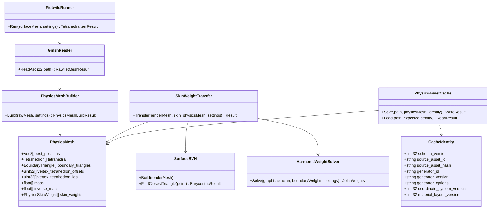
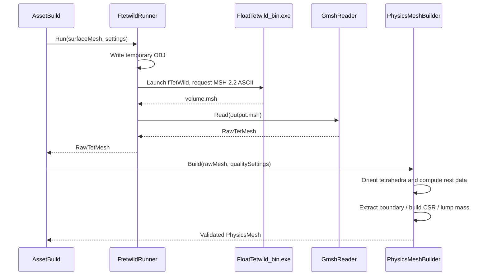
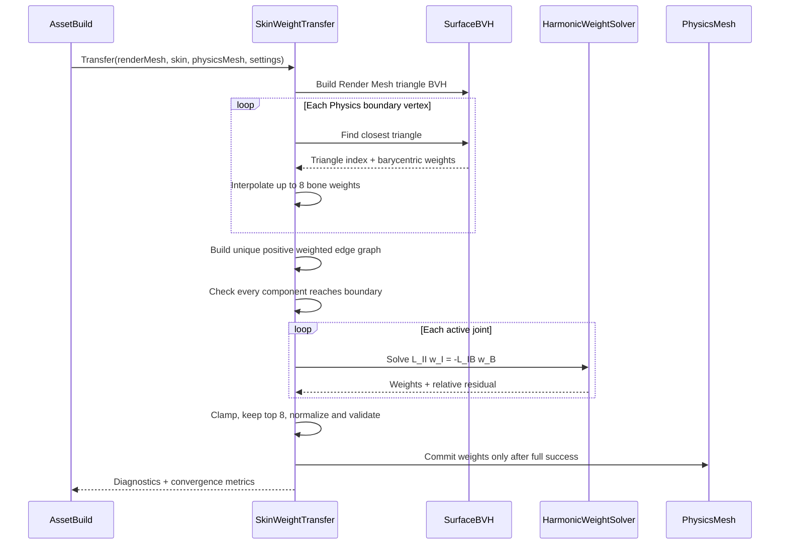
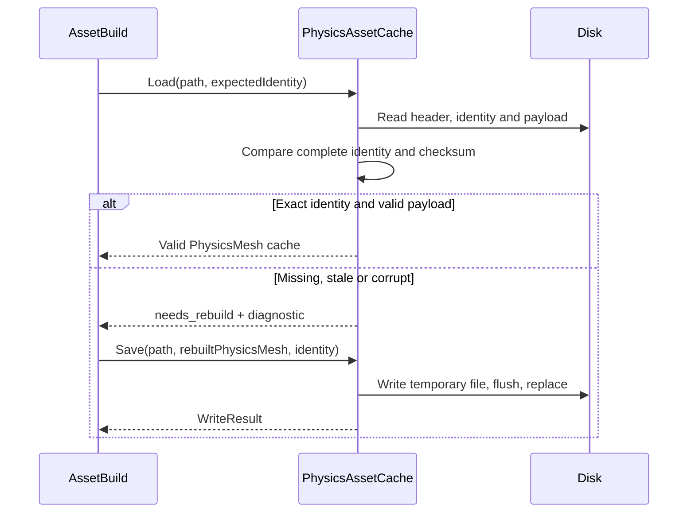

# Phase 2: Physics Mesh, Skin Weight and Cache UML

## Class diagram

## Physics Mesh generation sequence

## Skin weight transfer sequence

## Cache sequence

## Ownership and execution boundary

- fTetWild is an external offline executable; it is not linked into SkinPhysics and is not invoked by the runtime solver.
- PhysicsMeshBuilder owns orientation correction, element quality validation, rest matrix / shape gradient computation, boundary extraction, CSR adjacency, and lumped mass.
- SkinWeightTransfer is an offline Asset Build operation. It uses a BVH over Render Mesh triangles for boundary lookup and a positive graph Laplacian for interior weights.
- Skin weight transfer builds a temporary result and only commits it to PhysicsMesh after every component, solve residual, influence count and normalization check passes.
- PhysicsAssetCache stores deterministic data in an explicit little-endian format. The FNV-1a payload checksum detects accidental corruption; it is not a cryptographic authenticity mechanism. Source asset identity must therefore include a separately computed source hash.
- Cache identity mismatch, corrupt data, unsupported file versions and invalid payloads require an explicit rebuild. No invalid cache silently falls back to a partial PhysicsMesh.
- The current cache schema contains Physics Mesh rest data, mass, adjacency, boundary faces and optional skin weights. Future payload sections require a schema version increase and round-trip tests.
